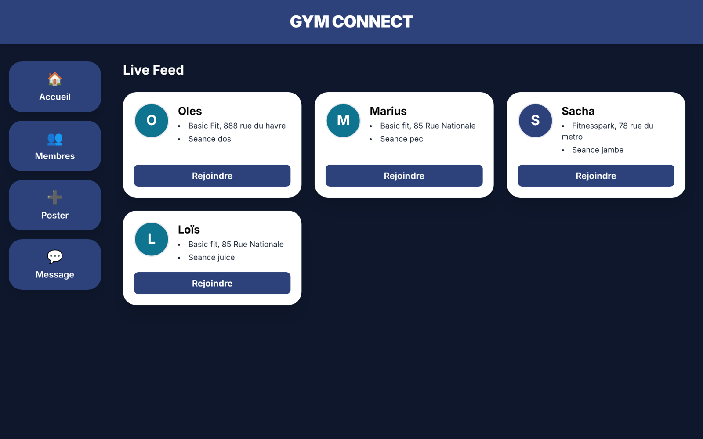
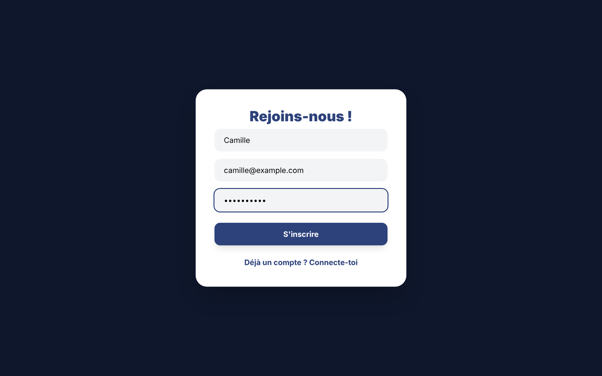
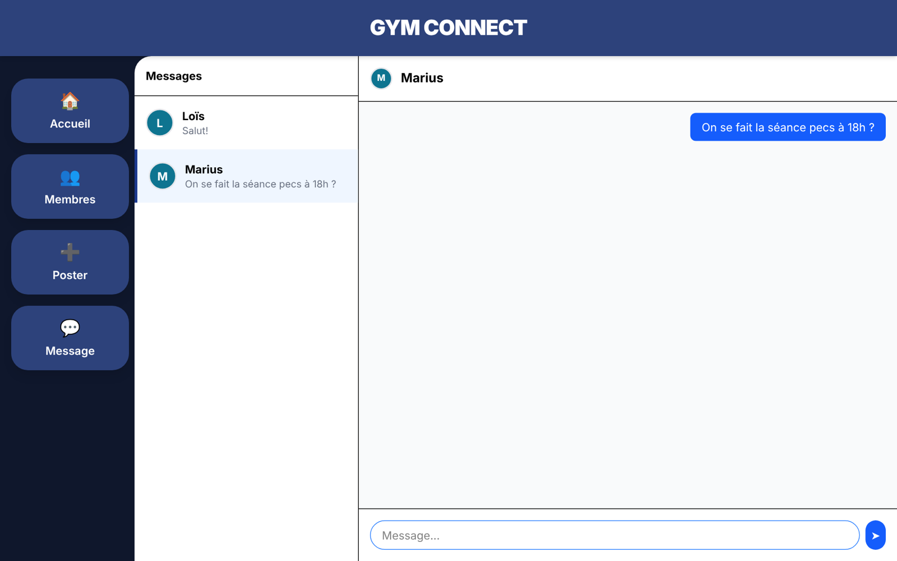
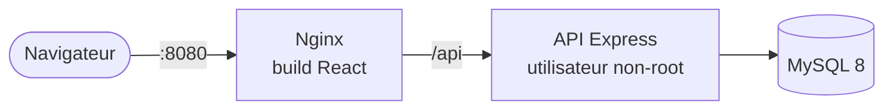

<div align="center">


# Gym Connect

**Trouver un partenaire de séance dans sa salle de sport, en quelques secondes.**

[](https://github.com/Lois5959/YOWL/actions/workflows/ci.yml)




</div>

---

## 🎯 Le problème

S'entraîner seul, c'est la première cause d'abandon. Et pour un squat lourd ou un développé couché, il faut
quelqu'un pour assurer. Les groupes WhatsApp sont noyés de messages et les applis de rencontre ne sont pas faites
pour ça.

**Gym Connect** transforme la salle en réseau collaboratif : je publie ma séance (**qui, où, quand, quoi**),
quelqu'un la rejoint, on s'organise par message.

Le projet suit une démarche produit complète : recherche, interviews, personas, parcours utilisateur, wireframes,
maquettes, tests et définition du MVP (voir [la documentation produit](#-démarche-produit)).

---

## ✨ Le MVP

<table>
<tr>
<td width="33%"></td>
<td width="33%"></td>
<td width="33%"></td>
</tr>
<tr>
<td align="center"><b>Compte</b><br><sub>inscription, connexion, session gardée</sub></td>
<td align="center"><b>Live Feed</b><br><sub>séances par salle et par type</sub></td>
<td align="center"><b>Messagerie</b><br><sub>« Rejoindre » ouvre la conversation</sub></td>
</tr>
</table>

| Fonctionnalité | État |
|---|---|
| Inscription et connexion (bcrypt + JWT) | ✅ reliée à l'API et à MySQL |
| Messages enregistrés en base (`/api/messages`) | ✅ API prête et testée |
| Fil des séances et messagerie dans l'interface | 🧪 prototype avec des données d'exemple |
| Publier une séance, filtrer par salle | 🔜 prochaine étape |

---

## ⚡ Démarrage rapide

Prérequis : **Docker** avec **Docker Compose v2**.

```bash
git clone https://github.com/Lois5959/YOWL.git
cd YOWL
cp .env.example .env        # puis changer JWT_SECRET : openssl rand -base64 48
docker compose up --build
```

Puis ouvrir **http://localhost:8080** et créer un compte.

| Service | Adresse | Remarque |
|---|---|---|
| Application | http://localhost:8080 | Nginx : front React + relais `/api` |
| API | http://127.0.0.1:3000 | Machine locale uniquement |
| phpMyAdmin | http://127.0.0.1:8084 | `docker compose --profile tools up` |

Arrêter : `docker compose down` (ajouter `-v` pour effacer aussi la base).

<details>
<summary><b>💻 Développer le front avec rechargement à chaud</b></summary>

<br>

```bash
docker compose up -d mysql_db backend
cd frontend && npm ci && npm run dev    # http://localhost:5173
```

Vite relaie `/api` vers `http://localhost:3000`.

</details>

---

## 🏗️ Architecture



- Démarrage dans l'ordre grâce aux **healthchecks** : MySQL prêt → API prête → front.
- Le front appelle `/api` sur **son propre domaine** : pas d'URL en dur, pas de CORS à gérer en production.
- MySQL n'est pas exposé ; l'API seulement sur `127.0.0.1`.

## 🔐 Sécurité

| Risque | Mesure |
|---|---|
| Mots de passe volés en base | Hachage **bcrypt** |
| Jeton falsifié | JWT signé avec `JWT_SECRET` ; l'API **refuse de démarrer** sans secret |
| Découvrir qui a un compte | Même message pour un email inconnu ou un mauvais mot de passe |
| Lire les emails des membres | `/api/users` réservé aux utilisateurs connectés |
| Envoyer un message au nom d'un autre | L'expéditeur vient du **jeton**, jamais du corps de la requête |
| Injection SQL | Requêtes 100 % paramétrées |
| Données invalides | Champs, format d'email, mot de passe ≥ 8 caractères, messages ≤ 1000 caractères |
| Secrets dans Git | `.env` ignoré, seul `.env.example` est versionné |

<details>
<summary><b>📡 Routes de l'API</b></summary>

<br>

| Méthode | Route | Accès |
|---|---|---|
| `GET` | `/api/health` | Public (API + base) |
| `POST` | `/api/auth/register` | Public |
| `POST` | `/api/auth/login` | Public → renvoie un jeton |
| `GET` | `/api/users` | Connecté |
| `POST` | `/api/messages` | Connecté · `{ receiverId, content }` |
| `GET` | `/api/messages/:userId` | Connecté · conversation avec ce membre |

</details>

## 🧪 Tests et CI

```bash
cd backend && npm ci && npm test        # 9 tests de l'API, sans base de données
cd frontend && npm ci && npm run lint && npm run build
```

La CI GitHub Actions lance les tests, le lint et le build, puis **démarre toute la stack avec Docker Compose**
et vérifie à travers Nginx : santé, inscription, connexion, refus sans jeton.

---

## 🧭 Démarche produit

| Étape | Document |
|---|---|
| 1. Recherche | [Problème](docs/01_research/problem_statement.md) · [Objectifs](docs/01_research/objectives_constraints.md) · [Benchmark](docs/01_research/benchmark.md) · [Interviews](docs/01_research/interviews.md) |
| 2. Personas | [Personas](docs/02_personas/personas.md) |
| 3. Parcours | [Parcours utilisateur](docs/03_user_journey/user_journey.md) |
| 4-5. Design | [Wireframes](docs/04_wireframes/) · [Maquettes et choix graphiques](docs/05_mockups/) |
| 6. Prototype | [Description](docs/06_prototype/prototype_description.md) |
| 7. Tests | [Protocole](docs/07_feedback/test_protocol.md) · [Retours](docs/07_feedback/feedback_summary.md) |
| 8. Priorisation | [Matrice](docs/08_prioritization/prioritization_matrix.md) · [Définition du MVP](docs/08_prioritization/mvp_definition.md) |
| 9. Pitch | [Pitch deck (PDF)](docs/09_pitch/pitch_deck.pdf) |

## 📁 Structure

```
.
├── backend/
│   ├── app.js              # application Express (routes, CORS, healthcheck)
│   ├── index.js            # démarrage (vérifie JWT_SECRET)
│   ├── routes/             # auth.js, messages.js
│   ├── middleware/auth.js  # vérification du jeton
│   ├── schema.sql          # tables utilisateurs et messages
│   └── test/               # node:test
├── frontend/
│   ├── src/                # React (Auth, Feed, ChatApp, Sidebar...)
│   ├── nginx.conf          # fichiers statiques + relais /api
│   └── Dockerfile          # build Node puis Nginx
├── docs/                   # démarche produit (01 → 09) et captures
├── docker-compose.yml
└── .env.example
```

---

<div align="center">

Projet d'équipe du module **B-TBM-100** (YOWL) · Bachelor Epitech Lille
**Loïs-Elie Ekollo** · Marius · Oles · Sacha

</div>
